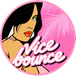

#  ViceBounce

Make Vice City bounce to your music.

  
  
   
  <b>$VB</b> · <code>BiXQXFrVoZAEagv2ikQ841RfgNYziwpQxed1dBuapump</code> · <b><a href="https://pump.fun/coin/BiXQXFrVoZAEagv2ikQ841RfgNYziwpQxed1dBuapump">pump.fun ↗</a></b>
   
  

  
   
  <a href="https://www.instagram.com/p/DepL4Fptbyn/">▶ Sound on: watch the full clip on Instagram</a>

  
   
  Also for
  <a href="https://github.com/tek-95/ViceBounce/releases/download/sa-v0.3.7/SABounce-0.3.7.zip"><b>San Andreas</b></a> ·
  <a href="https://github.com/Antriksh1984/LibertyBounce/releases/latest"><b>GTA III</b></a> ·
  <a href="https://github.com/tek-95/ViceBounce/releases">all releases</a>

Squash and stretch cars, bikes, boats, aircraft and people — including Tommy, passengers and cutscene actors. Optional modes add vegetation, buildings and street objects, with buildings moving vertically from their ground anchor.

## What's new in 1.0.0

-  **ViceBounce menu on F11.** Music, grouped bounce controls and **More settings** in one panel styled after Vice City's own menus. It opens anywhere — on foot, in vehicles, on pause — and the game keeps playing: only the arrows, Enter, Backspace and Esc go to the menu.
-  **Change track from the menu.** Select the track row and press Enter to pick a new MP3, FLAC, WAV or OGG.
-  **UK bounce curve** — the snappy Toyota Yaris meme style. Switch with **/** or choose **Bounce style** in **More settings**.
-  **Pause the music in place** with **`** or **Pause**; the squash keeps the beat.
-  **Update notices and developer news** inside the menu. Checked at most once a day, nothing installs itself.
-  **New hotkeys** — see [Controls](#controls) before playing.

## Install

Requires **GTA Vice City** (**classic Steam**, **retail 1.0** or **1.1**), **Windows 10/11 x64** and an [**ASI loader**](https://github.com/ThirteenAG/Ultimate-ASI-Loader) that loads plugins from `scripts`.

1. Close the game. If you don't already have an ASI loader, download [Ultimate ASI Loader — d3d8, Win32](https://github.com/ThirteenAG/Ultimate-ASI-Loader/releases/download/Win32-latest/d3d8-Win32.zip) and extract `d3d8.dll` next to `gta-vc.exe`. Use **Win32**, even on 64-bit Windows. [Loader instructions](https://github.com/ThirteenAG/Ultimate-ASI-Loader#installation).
2. Download ViceBounce from [Releases](https://github.com/tek-95/ViceBounce/releases) and copy the ZIP's `scripts` contents into the game's `scripts` folder (create it if needed).

Keep your existing `ViceBounce.ini` when updating. If `d3d8.dll` already exists, back it up and check your existing loader before replacing it.

The mod checks executable compatibility on startup. If the checks fail, it disables itself and records the reason in `ViceBounce.log`.

## Music

Press **F11**, select the track row and press **Enter** (**Change**) to choose your own **MP3, FLAC, WAV or OGG**. The importer analyzes the beat and prepares looping playback locally. No Python installation needed. Music is not included or uploaded. The game minimizes while you choose a file and returns when the importer closes.

Press **`** (the key below Esc) or **Pause** to pause and resume the music in place. The squash keeps running on the configured BPM while the track is paused.

Use **F10** to adjust alignment by ear. Automatic beat detection can make mistakes.

## Controls

**Controls updated in 1.0.0** — check the hotkeys below before playing.

| Key | Action |
| --- | --- |
| F4 | Buildings |
| F5 | Vegetation |
| F6 | Cars and cutscenes |
| F7 | Street objects |
| F8 | Bikes, boats and aircraft |
| F9 | Everyone, including Tommy |
| F10 | Align the beat |
| F11 | Open / close ViceBounce menu |
| ` or Pause | Pause / resume music |
| - / = | Manual BPM ∓5; disables beat map |
| , / . | Amplitude ∓0.025 |
| / | Russian style / UK style |
| End | Reload settings |

The defaults avoid Vice City's own keys (F1–F3 replays, Page Up/Down sniper zoom, Home camera) and letters, so typing cheats never toggles anything. Change any key in the `[Keys]` section of `ViceBounce.ini`.

**Russian style** is the classic smooth squash. **UK style** is the snappy one from the Toyota Yaris meme; pick its curve with `UKEasing`.

Settings save automatically. Reloading keeps the current track playing unless the music file changed. Ctrl+Shift+F11 stays available for OBS.

## Other GTA games

| Game | Mod | Author | Where |
| --- | --- | --- | --- |
| Vice City | ViceBounce | [@tek-95](https://github.com/tek-95) | you are here (`main`) |
| San Andreas | SABounce | [@wakeupdanny-dev](https://github.com/wakeupdanny-dev) | [branch `san-andreas`](https://github.com/tek-95/ViceBounce/tree/san-andreas) · [release](https://github.com/tek-95/ViceBounce/releases/tag/sa-v0.3.7) |
| GTA III | LibertyBounce | [@Antriksh1984](https://github.com/Antriksh1984) | [Antriksh1984/LibertyBounce](https://github.com/Antriksh1984/LibertyBounce) |

## Support me

  
  

More of my stuff: [tek-95.com](https://tek-95.com) · [Instagram](https://instagram.com/tek__95)

## Credits

Inspired by [CarbonBounce](https://github.com/giovannosaur/CarbonBounce), where the UK style curves come from. Built with [Plugin-SDK](https://github.com/DK22Pac/plugin-sdk).

Thanks to [@mrpulpe99](https://github.com/mrpulpe99) for retail 1.0 support and executable verification ([#2](https://github.com/tek-95/ViceBounce/pull/2)), [@LZQCN](https://github.com/LZQCN) for music pause ([#5](https://github.com/tek-95/ViceBounce/pull/5)), and [@mattpannella](https://github.com/mattpannella) for the building-bounce proposal ([#1](https://github.com/tek-95/ViceBounce/pull/1)).

[MIT license](LICENSE.txt). Dependencies retain their own licenses. [Importer build instructions](importer/BUILD.md).
